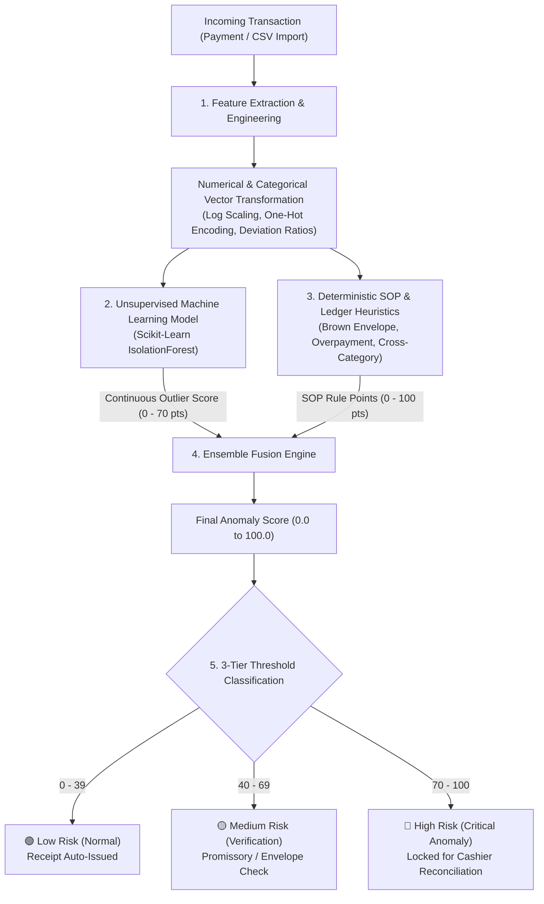

# CCA FlowSys: Machine Learning-Based Anomaly Detection & System Requirements Specification

---

## 1. Machine Learning-Based Anomaly Detection Architecture

### 1.1 Overview
The CCA FlowSys (CashFlow Management System) implements an **Ensemble Machine Learning & Heuristic Anomaly Detection Engine**. It bridges the gap between statistical machine learning and institutional accounting rules (DepEd & CCA Cashier Standard Operating Procedures), preventing revenue loss, identifying clerical errors, and detecting potential financial fraud in real time.



---

### 1.2 Defense & Technical Justification: Why This Is Genuinely Machine Learning

When presenting or defending this feature in an academic or technical evaluation (e.g., thesis defense), the following technical arguments prove that this system uses genuine Machine Learning rather than static, hardcoded `if-else` checks:

#### A. Unsupervised Learning via Isolation Forest (`IsolationForest`)
* **Algorithm:** The core engine leverages `sklearn.ensemble.IsolationForest`, a recognized tree-based ensemble algorithm explicitly built for high-dimensional anomaly detection.
* **Mathematical Foundation:** Rather than attempting to profile "normal" data points (which can lead to overfitting or high false-positive rates), Isolation Forest explicitly isolates outliers. It builds an ensemble of $100$ randomized decision trees (`n_estimators=100`). Anomalous data points have significantly shorter path lengths from the root node to their terminating leaf nodes compared to normal transaction clusters:
  $$s(x, n) = 2^{-\frac{E(h(x))}{c(n)}}$$
  Where:
  * $h(x)$ is the path length of observation $x$ in an isolation tree.
  * $E(h(x))$ is the expectation of $h(x)$ over an ensemble of trees.
  * $c(n) = 2 \ln(n - 1) + 0.5772156649 - \frac{2(n - 1)}{n}$ is the average path length of an unsuccessful search in a Binary Search Tree (BST) with $n$ nodes.

#### B. Continuous Multi-Dimensional Feature Space
Hardcoded rules only test single scalar conditions (e.g., `amount > 5000`). Our machine learning engine projects every transaction into a multi-dimensional continuous feature matrix:
```python
feature_vector = [
    math.log1p(inc.amount),          # Logarithmic non-linear scaling for monetary amounts
    *one_hot_category_vector,        # One-hot encoded categorical fee space
    float(expected_diff_ratio),      # Relative deviation from dynamic expected fee benchmarks
    float(ratio_to_category_mean),   # Normalized variance against current cluster mean
    1.0 if inc.is_partial else 0.0   # Binary classification flag for partial installments
]
```
The Isolation Forest evaluates non-linear multi-attribute interactions across this entire vector simultaneously.

#### C. Unsupervised Cluster Discovery (No Pre-Labeled Data Required)
In a real-world educational cashier setting, school administrators do not have thousands of pre-labeled "fraudulent" or "erroneous" historical samples. Our model is **unsupervised**:
1. It ingests active ledger entries without ground-truth labels.
2. It dynamically computes cluster distributions (means $\mu$, standard deviations $\sigma$, and student historical averages).
3. It identifies transactions that fall into low-density, isolated regions of the data hyperspace.

#### D. The Ensemble Scoring Formula
To guarantee that algorithmic outlier detection does not conflict with strict institutional rules, our engine utilizes a calibrated ensemble:
$$\text{Final Score} = \max\left(\text{Rule Score}, (0.40 \times \text{Rule Score}) + (0.60 \times \text{ML Outlier Score})\right)$$
* For low-risk baseline items, the score is balanced $(0.50 \times \text{Rule} + 0.50 \times \text{ML})$.
* If a critical SOP rule or ledger ceiling is violated, the deterministic score guarantees that the model will not falsely suppress the risk level.

---

### 1.3 Step-by-Step Processing Lifecycle

1. **Pre-Save Interception:**
   When a payment is entered (manually by the Cashier or uploaded in batch via CSV), the raw transaction payload is intercepted prior to writing to the financial ledger.

2. **Feature Engineering & Normalization:**
   * Monetary amounts are log-transformed via $\ln(1 + x)$ to dampen extreme skewness.
   * Categories are one-hot encoded into binary vectors.
   * Dynamic statistical ratios (distance to category mean, historical student payment average) are synthesized.

3. **Isolation Tree Partitioning:**
   The feature matrix is passed to `IsolationForest(n_estimators=100, contamination="auto", random_state=42)`. Decision function scores are extracted and normalized to an outlier scale between $0$ and $70$.

4. **SOP Domain & Ledger Cross-Checks:**
   The heuristic pipeline cross-validates specific school policies:
   * **Brown Envelope Verification:** Penalizes unverified cash envelopes (+45 pts).
   * **Outstanding Balance Overpayment:** Penalizes collections exceeding the student's remaining ledger debt (+75 to +95 pts).
   * **Cross-Category Mismatch / Fee Dumping:** Detects when an amount exactly matches a Tuition benchmark (e.g., ₱1,906) but is misclassified under Energy or Books (+60 to +75 pts).
   * **Rapid Submission / Duplicate Detection:** Flags identical student payments entered within 60 minutes (+80 pts).

5. **3-Tier Risk Classification:**
   * 🟢 **Low Risk (0 – 39):** Healthy transaction. Complies with fee benchmarks. Official Receipt issued automatically.
   * 🟡 **Medium Risk (40 – 69):** Moderate anomaly. Requires cashier verification (e.g., partial payment without documented installment agreement, unverified envelope).
   * 🔴 **High Risk (70 – 100):** Critical anomaly. Action required. Potential double collection, severe overpayment, or category dumping.

6. **Explainable AI (XAI) Output & Resolution Audit:**
   Each transaction stores a machine-readable JSON object with human-readable diagnostic reasons and actionable recommendations. Cashiers can reconcile records with physical envelopes and mark them as "Verified & Cleared" with complete audit logging.

---

## 2. System Requirements Specification

### 2.1 Software Requirements

#### A. Backend Architecture
| Component | Requirement | Purpose |
|:---|:---|:---|
| **Operating System** | Windows 10/11 (64-bit), Ubuntu 20.04/22.04 LTS, or macOS 12+ | Host operating environment |
| **Python Runtime** | Python `3.10.x` – `3.12.x` (64-bit) | Backend script and API execution |
| **Web API Framework** | FastAPI (`>= 0.115.0`) | High-performance asynchronous REST API |
| **ASGI Web Server** | Uvicorn (`>= 0.30.0`) | Lightning-fast ASGI application server |
| **Machine Learning** | Scikit-Learn (`>= 1.4.0`) | Isolation Forest anomaly detection engine |
| **Scientific Computing** | NumPy (`>= 1.26.0`) | Vector operations and numerical transformations |
| **Database ORM** | SQLAlchemy (`>= 2.0.35`) | Object-Relational Mapping and SQL generation |
| **Database Engine** | SQLite 3 (Built-in) / PostgreSQL `14.0+` | Relational persistence of ledger and ML metadata |
| **Data Validation** | Pydantic (`>= 2.9.0`) | Strict runtime request and schema validation |
| **Authentication & Security** | `python-jose[cryptography] >= 3.3.0`<br>`passlib[bcrypt] >= 1.7.4` | JWT access tokens and salted password hashing |

#### B. Frontend Architecture
| Component | Requirement | Purpose |
|:---|:---|:---|
| **Core Library** | React `19.2.x` | Modern reactive user interface components |
| **Build Tooling** | Vite (`>= 6.x` / `8.x`) | Fast HMR development and optimized production bundling |
| **Styling Framework** | Tailwind CSS (`v4.x`) | Utility-first responsive design system |
| **Data Charting** | Recharts (`>= 3.10.0`) | Real-time interactive financial telemetry & charts |
| **UI Iconography** | Lucide React (`>= 1.57.0`) | Clean, accessible dashboard and action icons |
| **HTTP Communication** | Axios (`>= 1.20.0`) | Client-to-backend REST API integration |

#### C. Client Environment
* **Modern Web Browser:** Google Chrome 110+, Microsoft Edge 110+, Mozilla Firefox 115+, or Apple Safari 16+ (JavaScript enabled).

---

### 2.2 Hardware Requirements

#### A. Server / Host Machine (Running Backend, Machine Learning Engine & Database)

| Component | Minimum Specification | Recommended Specification |
|:---|:---|:---|
| **Processor (CPU)** | Dual-Core 64-bit Processor (2.0 GHz or higher)<br>*(e.g., Intel Core i3 7th Gen / AMD Ryzen 3)* | Quad-Core 64-bit Processor (3.0 GHz or higher)<br>*(e.g., Intel Core i5 10th Gen / AMD Ryzen 5 or cloud vCPU equivalent)* |
| **Random Access Memory (RAM)** | 4 GB DDR4 | 8 GB or 16 GB DDR4/DDR5 *(Provides rapid in-memory Isolation Forest model fitting)* |
| **Storage Capacity** | 20 GB available SSD space | 50 GB+ NVMe SSD *(Accelerates SQLite WAL mode and audit log read/writes)* |
| **Network Interface** | Standard 10/100 Mbps Ethernet adapter | 1 Gbps Gigabit Ethernet or enterprise Wi-Fi 5/6 |

#### B. Client Workstation (Cashier, Registrar, and Administrator Terminals)

| Component | Minimum Specification | Recommended Specification |
|:---|:---|:---|
| **Processor (CPU)** | 1.6 GHz Dual-Core 64-bit Processor | 2.4 GHz Quad-Core Processor or higher |
| **Memory (RAM)** | 4 GB RAM | 8 GB RAM |
| **Display Resolution** | $1366 \times 768$ (HD Ready) | $1920 \times 1080$ (Full HD 1080p) for high-density tabular ledgers |
| **Input Devices** | Standard Keyboard, Mouse / Trackpad | Keyboard with dedicated numeric keypad |
| **Peripherals** | Standard Thermal/Laser Printer | Laser printer for official DepEd soft-copy receipts and monthly reports |
